# DSO202 Assignment 2: StatefulSet and Ingress

## Overview

In Assignment 1 I deployed a three-tier Task Tracker (frontend, backend, database) on my kind cluster. In Assignment 2 I applied the Unit II concepts to it:

- **StatefulSet:** the database runs as a StatefulSet, so it gets a stable name (`db-0`), a stable DNS address and its own storage (PVC).
- **Ingress:** the NGINX Ingress Controller is the single entry point. `/api` goes to the backend and `/` goes to the frontend.

### Changes made

| Part | Before | Now |
|---|---|---|
| Database | Deployment + PVC | StatefulSet `db` + headless Service `db-svc` |
| Backend → DB | `db-svc` | `db-0.db-svc` (stable Pod DNS name) |
| Browser → Backend | `http://backend-svc:8080` (failed) | Through the Ingress (works) |
| Frontend Service | NodePort | ClusterIP (only reachable through the Ingress) |
| Ingress | No host | Host `tasktracker.localhost`, paths `/api` and `/` |
| Replicas | 1 backend, 1 frontend | 2 backend, 2 frontend |


---

## 1. Namespace and Configuration

I created a new namespace `dso202-assignment-02-v2`, set it as my default, and applied the ConfigMap, Secret, ResourceQuota and LimitRange.

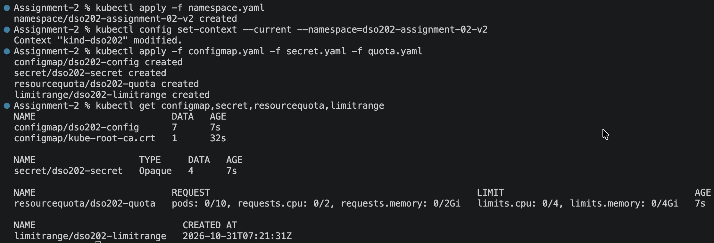

*Figure 1: Namespace, ConfigMap, Secret, ResourceQuota and LimitRange created successfully.*

---

## 2. StatefulSet

### 2.1 Creating the StatefulSet

The database uses a headless Service (`clusterIP: None`) and a `volumeClaimTemplates` section, which creates one PVC for each Pod.

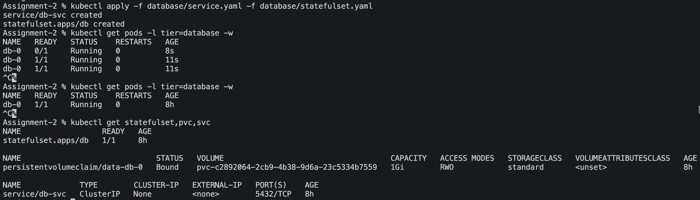

*Figure 2: StatefulSet created Pod `db-0`, PVC `data-db-0` is Bound, and `db-svc` is headless (ClusterIP: None).*

### 2.2 Stable DNS name

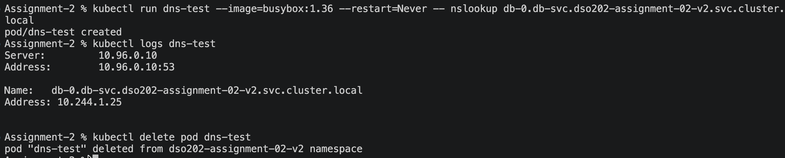

*Figure 3: `db-0.db-svc` resolves to the db-0 Pod IP. The backend uses this name to connect to the database.*

---

## 3. Backend and Frontend

Both run as Deployments with **2 replicas**, managed by a ReplicaSet. All Services are **ClusterIP**, so nothing is exposed directly.

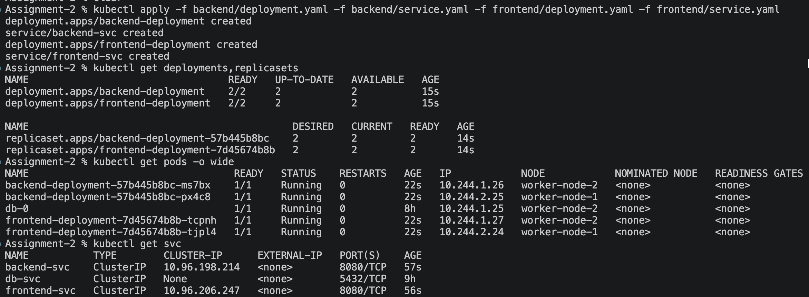

*Figure 4: Backend and frontend each have 2 Pods running across both worker nodes, and all Services are ClusterIP.*

---

## 4. Ingress

### 4.1 Ingress Controller

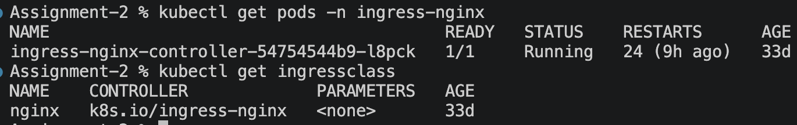

*Figure 5: The NGINX Ingress Controller is running and the `nginx` IngressClass exists.*

An Ingress needs a controller to work. Without one, the Ingress object does nothing.

### 4.2 Creating the Ingress

```yaml
rules:
  - host: tasktracker.localhost
    http:
      paths:
        - path: /api       → backend-svc:8080
        - path: /          → frontend-svc:8080
```

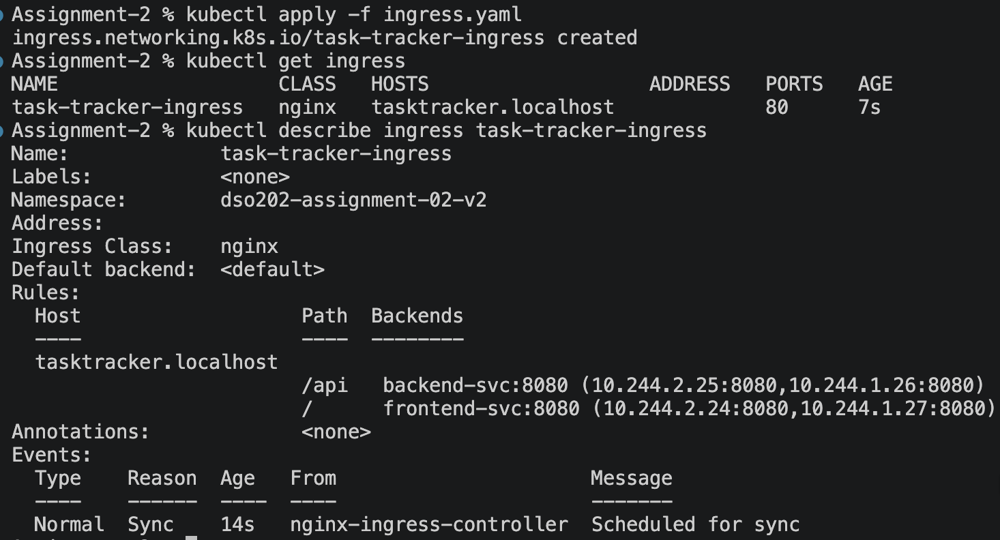

*Figure 6: The Ingress routes `/api` to the 2 backend Pods and `/` to the 2 frontend Pods.*

### 4.3 Testing through the Ingress

I port-forwarded the Ingress Controller in a second terminal:

```bash
kubectl port-forward -n ingress-nginx svc/ingress-nginx-controller 8888:80
```

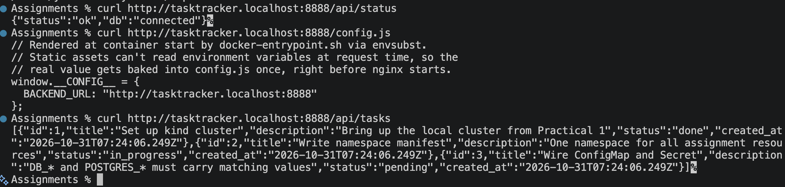

*Figure 7: `/api/status` returns `db: connected`, `config.js` now points to the Ingress address, and `/api/tasks` returns the tasks.*

### 4.4 CRUD through the Ingress

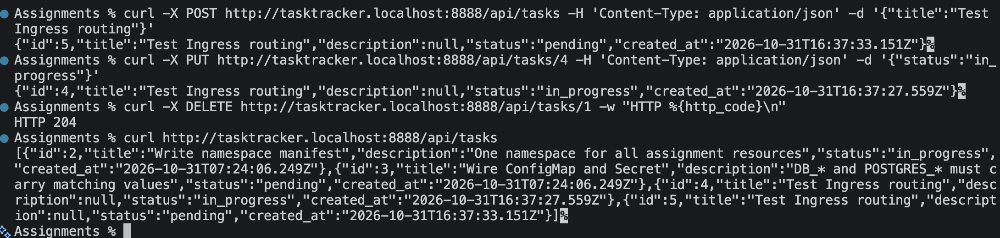

*Figure 8: Create (POST), Update (PUT), Delete (DELETE) and Read (GET) all work through the Ingress.*

### 4.5 Frontend in the browser

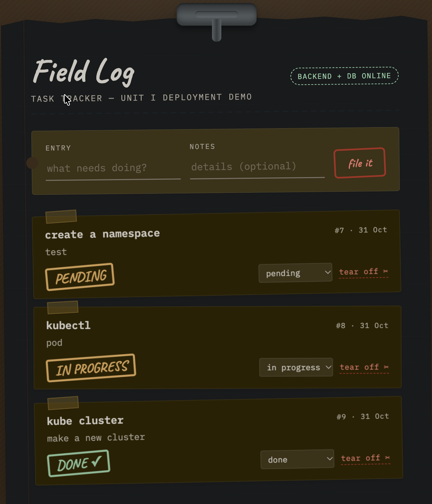

*Figure 9: The frontend now shows "BACKEND + DB ONLINE", and I added tasks using the web form.*

This proves the fix works. In my first attempt this page showed "Backend unreachable".

---

## 5. StatefulSet Behaviour

### 5.1 Scaling up

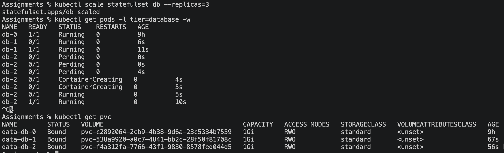

*Figure 10: After scaling to 3, Pods were created in order (db-1, then db-2), and each Pod got its own PVC.*

`db-2` only started after `db-1` was Ready (`1/1`). This is the ordered startup of a StatefulSet.

### 5.2 Scaling down

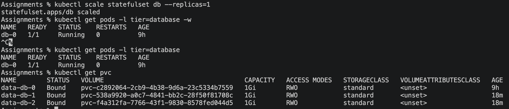

*Figure 11: After scaling back to 1, only db-0 remains, but all 3 PVCs are kept.*

The PVCs were not deleted because I set `whenScaled: Retain`. If I scale up again, db-1 and db-2 get their old data back.

### 5.3 Deleting db-0

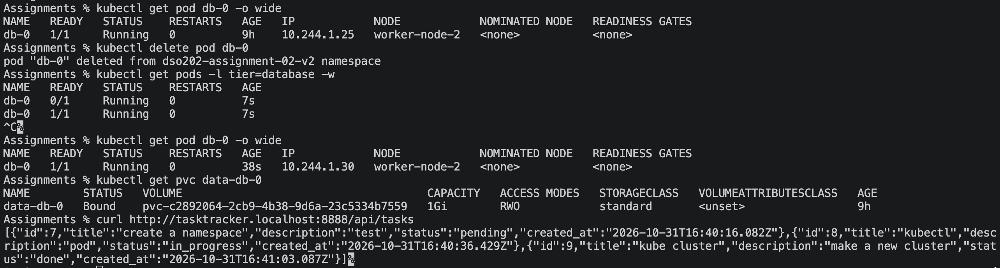

*Figure 12: After deleting db-0, it came back with the same name and the same PVC, and the tasks are still there.*

| | Before | After |
|---|---|---|
| Name | db-0 | db-0 (same) |
| PVC | data-db-0 | data-db-0 (same) |
| IP | 10.244.1.25 | 10.244.1.30 (changed) |

The IP changed, but the backend connects by name (`db-0.db-svc`), so it still works. Tasks 7, 8 and 9 (created in Figure 9) are still in the database, so the data was not lost.

---

## 6. ReplicaSet Self-Healing

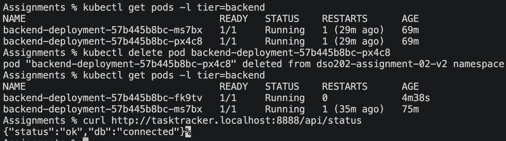

*Figure 13: After I deleted backend Pod `px4c8`, the ReplicaSet created a new Pod `fk9tv`, and the app kept working.*

The other backend Pod kept serving requests, so the app never went down.

**Note:** both backend Pods show `RESTARTS 1`. This happened when I deleted db-0 in Figure 12: the database connection was cut and the backend restarted once. Kubernetes restarted it automatically and it reconnected on its own.

---

## 7. Final State

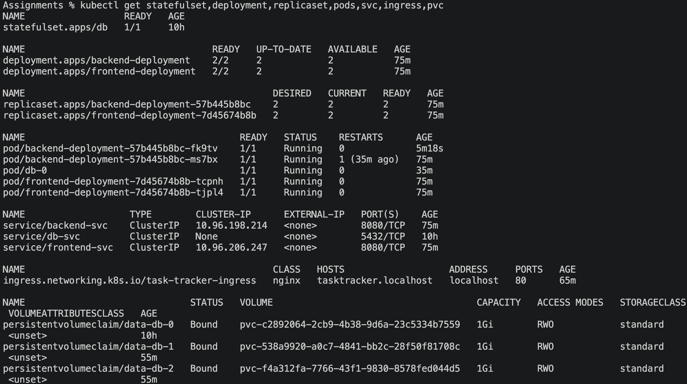

*Figure 14: Final state: StatefulSet 1/1, both Deployments 2/2, all Services ClusterIP, the Ingress on `tasktracker.localhost`, and 3 PVCs kept.*

---

## 8. File Structure

```
Assignment-2/
├── README.md
├── namespace.yaml
├── configmap.yaml        # DB_HOST and BACKEND_URL
├── secret.yaml
├── quota.yaml
├── ingress.yaml
├── database/
│   ├── service.yaml      # headless Service
│   └── statefulset.yaml
├── backend/
│   ├── deployment.yaml   # 2 replicas
│   └── service.yaml
├── frontend/
│   ├── deployment.yaml   # 2 replicas
│   └── service.yaml
└── evidence/             # 1.png – 14.png
```

---

## 9. Conclusion

The StatefulSet and Ingress configurations were implemented and verified successfully. After restarting, the database preserved its identity and persistent storage and the backend established the connection with the database.

The Ingress Controller worked properly in routing the requests to both the frontend and backend services. To sum up, the operation of the critical components in Kubernetes used in this part of the work proved to be consistent with the expectations.
