## Practical 4: GitOps with Argo CD

## Objective
- Learn GitOps using Argo CD to deploy an application to Kubernetes from GitHub.
- Understand how Git acts as the single source of truth.
- Test self-healing by making manual changes in the cluster.
- Test pruning by removing resources from Git and checking if Argo CD deletes them from the cluster.


## Environment

| Item | Details |
|---|---|
| Machine | macOS (Apple Silicon, arm64) with Docker Desktop |
| Cluster | Kind cluster `dso202` – 1 control-plane + 2 worker nodes, Kubernetes v1.36.1 |
| GitOps tool | Argo CD v3.6.1 (namespace `argocd`) |
| Git repository | `https://github.com/Kinleyjigs/DSO202_practicals` (public) |
| Manifests path | `practicals/dso202-practical-04/manifests` |
| Application | `nginxdemos/hello:plain-text` – Deployment `webapp-deploy` + Service `webapp-svc` in namespace `demo-app` |

**Files in this practical**

```
dso202-practical-04/
├── argocd-app.yaml          # Argo CD Application
├── manifests/
│   ├── deployment.yaml      # Desired state: webapp Deployment
│   └── service.yaml         # Desired state: webapp Service
└── assets/                  # Screenshots
```

> Note: The lab recommends a separate config repo. For this class I used a folder inside my practicals repo – Argo CD only reads the `manifests` folder path, so it works the same way.

## Procedure and Observations

### Step 1: Check the cluster

```bash
kubectl config use-context kind-dso202
kubectl get nodes
```

All 3 nodes (control-plane, worker-node-1, worker-node-2) are `Ready`.

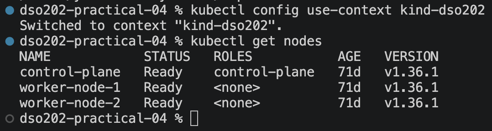

### Step 2: Install Argo CD

```bash
kubectl create namespace argocd
kubectl apply -n argocd --server-side --force-conflicts -f https://raw.githubusercontent.com/argoproj/argo-cd/stable/manifests/install.yaml
kubectl wait --for=condition=Ready pods --all -n argocd --timeout=300s
kubectl get pods -n argocd
```

All 7 Argo CD pods are `Running` – including `argocd-server` (UI/API), `argocd-repo-server` (clones Git) and `argocd-application-controller` (compares Git vs cluster).

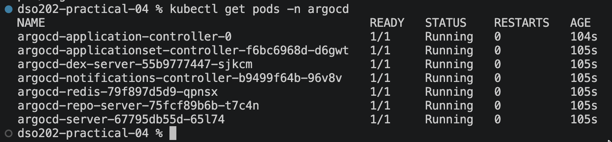

### Step 3: Access the Argo CD UI

Get the initial admin password (stored as a base64 Secret):

```bash
kubectl -n argocd get secret argocd-initial-admin-secret -o jsonpath="{.data.password}" | base64 -d; echo
```

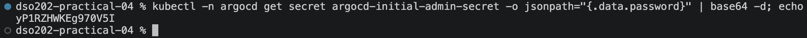

Forward local port 8080 to the Argo CD server (kept running in a separate terminal):

```bash
kubectl port-forward svc/argocd-server -n argocd 8080:443
```

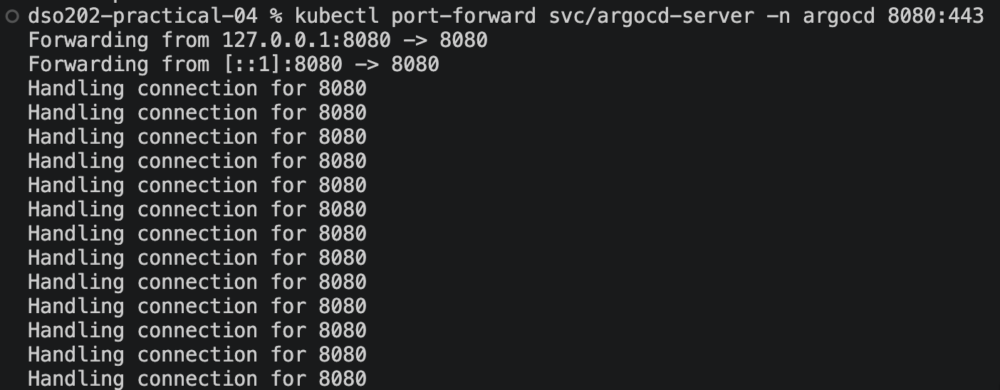

Logged in at `https://localhost:8080` as `admin`.

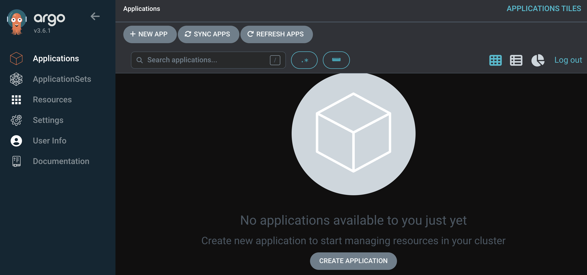

### Step 4: Desired state in Git

Created `manifests/deployment.yaml` (2 replicas of `nginxdemos/hello`) and `manifests/service.yaml` (ClusterIP on port 80), then pushed to GitHub:

```bash
git add manifests
git commit -m "Practical 4: initial deployment with 2 replicas"
git push origin main
```

### Step 5: Register the app in Argo CD (declaratively)

Instead of using the UI, the Argo CD Application is itself a YAML file (`argocd-app.yaml`):

```yaml
spec:
  source:
    repoURL: https://github.com/Kinleyjigs/DSO202_practicals.git
    targetRevision: HEAD
    path: practicals/dso202-practical-04/manifests
  destination:
    server: https://kubernetes.default.svc
    namespace: demo-app
  syncPolicy:
    automated:
      prune: true       # delete resources removed from Git
      selfHeal: true    # undo manual kubectl changes
    syncOptions:
      - CreateNamespace=true
```

```bash
kubectl apply -f argocd-app.yaml
```

The `my-webapp` app appeared and became **Healthy + Synced**, showing the repo, path and `demo-app` namespace.

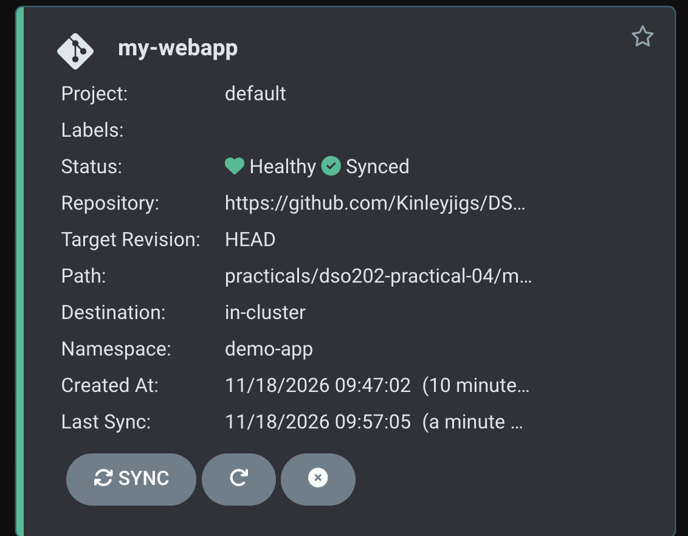

The tree view shows Argo CD created everything from Git: **Application → Service + Deployment → ReplicaSet → 2 Pods**.

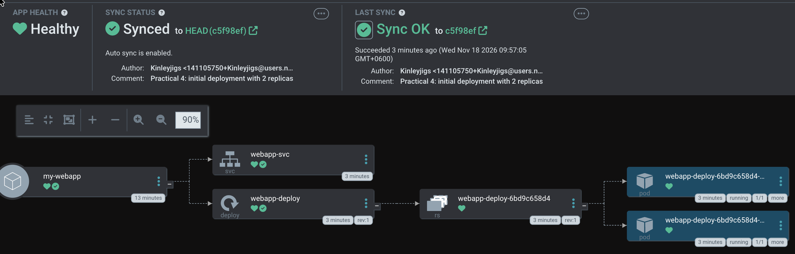

```bash
kubectl get pods -n demo-app -o wide
```

2 pods running, spread across the worker nodes.

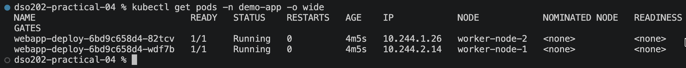

### Step 6: Experiment 1: Git as the single source of truth (scale 2 → 4)

Changed `replicas: 2` to `replicas: 4` in Git only no `kubectl scale`:

```bash
sed -i '' 's/replicas: 2/replicas: 4/' manifests/deployment.yaml
git add manifests/deployment.yaml
git commit -m "Scale webapp from 2 to 4 replicas"
git push origin main
```

After clicking **Refresh**, Argo CD synced to the new commit `4688cf4` ("Scale webapp from 2 to 4 replicas") and created 2 extra pods.

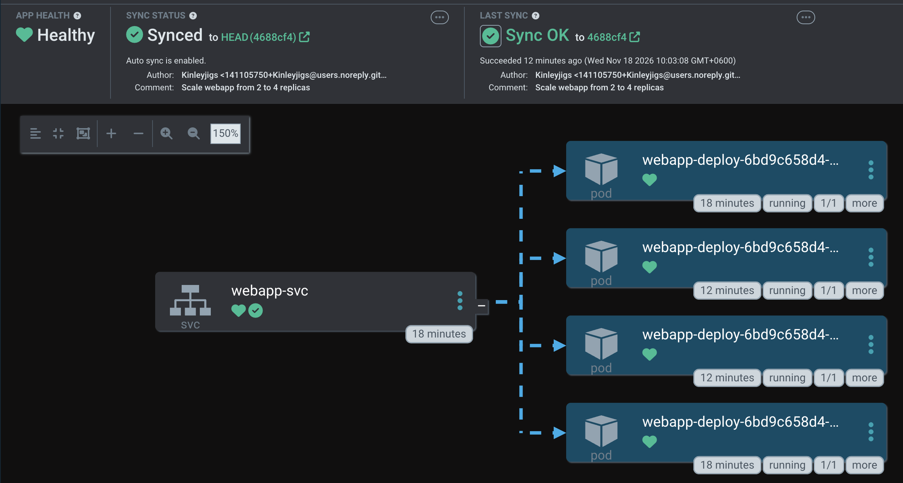

```bash
kubectl get pods -n demo-app -o wide
```

4 pods running, 2 old ones and 2 new ones (younger age).

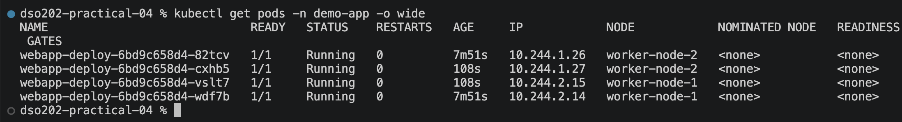

**Observation:** The cluster changed only because Git changed. The commit message and author are visible in Argo CD, so every change is traceable.

### Step 7: Experiment 2: Configuration drift & self-healing

Acted as a "rogue admin" and scaled down manually, bypassing Git:

```bash
kubectl scale deployment webapp-deploy -n demo-app --replicas=1 && kubectl get pods -n demo-app -w
kubectl get deployment webapp-deploy -n demo-app
```

3 pods went to `Terminating`, and within about **1 second** Argo CD created 3 new pods (age `0s`) to bring it back to **4/4**, because Git still says `replicas: 4`.

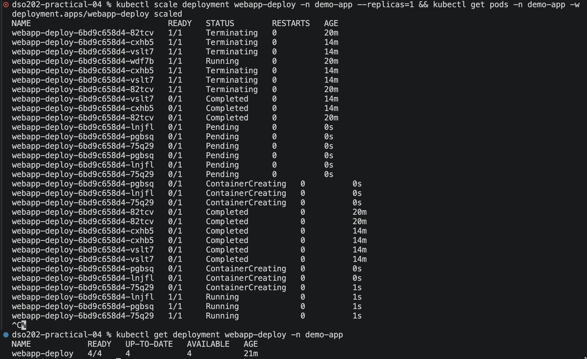

**Observation:** With `selfHeal: true`, manual `kubectl` changes don't last – Git always wins. This prevents configuration drift.

### Step 8: Experiment 3: Automatic pruning

Deleted `service.yaml` from Git:

```bash
kubectl get svc -n demo-app
git rm manifests/service.yaml
git commit -m "Remove webapp service to test pruning"
git push origin main
kubectl get svc -n demo-app
```

After refresh, `webapp-svc` disappeared from the Argo CD tree, only the Deployment, ReplicaSet and pods remain.

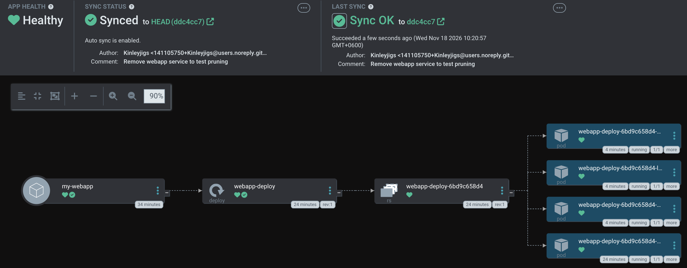

Before: `webapp-svc` existed. After: `No resources found in demo-app namespace`.

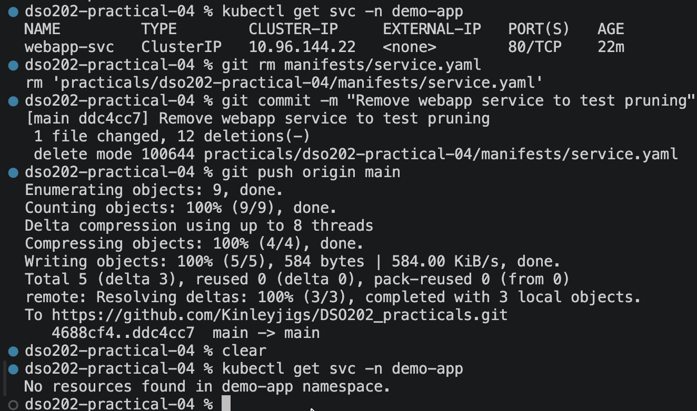

**Observation:** With `prune: true`, deleting a file from Git deletes the matching resource from the cluster.

### Step 9: Rollback with `git revert` (optional)

```bash
git revert HEAD --no-edit
git push origin main
```

Argo CD synced to the revert commit `fdf0cfe` and recreated `webapp-svc` (age "a few seconds"). The 3 pods aged "7 minutes" are the ones recreated by self-healing in Experiment 2.

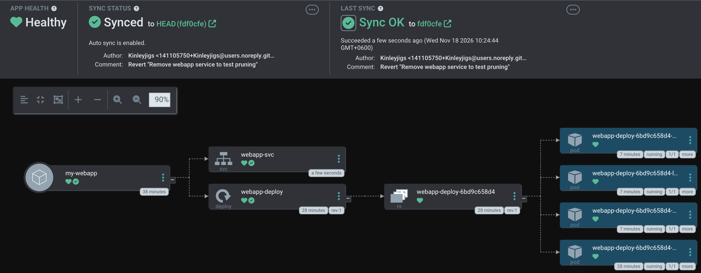

```bash
kubectl get svc -n demo-app
git log --oneline -5
```

The Service is back, and `git log` gives a full audit trail of every deployment change: initial deploy → scale to 4 → remove service → revert.

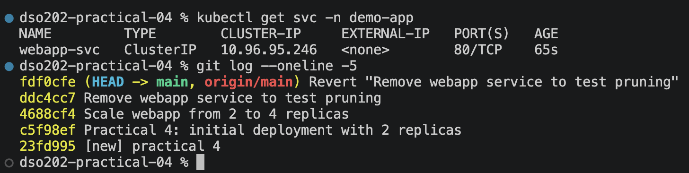

### Step 10: Cleanup

The lab's cleanup is `kind delete cluster --name dso202`, but I need the cluster for later work, so I only stopped the containers instead:

```bash
docker stop dso202-control-plane dso202-worker dso202-worker2
```


### Problems Faced and Fixes

| Problem | Fix |
|---|---|
| Old Argo CD installation caused conflicts. | Deleted the old namespace and reinstalled Argo CD. |
| Kind DNS issue after Docker restart. | Restarted the networking, DNS, and Argo CD pods. |
| Port-forward stopped working. | Ran the port-forward command again. |
| Self-healing test did not work at first. | Ran the scale and watch commands together. |


## Reflection
### What I Learned

Through this practical, I learned how GitOps works and how Argo CD uses a pull-based approach to keep the cluster updated from Git. I understood that Git acts as the main source of truth, where changes such as scaling, updating, and rolling back applications can be done by editing YAML files. I also learned how self-healing automatically fixes manual changes in the cluster and how pruning removes resources that are no longer needed. Another important thing I learned is that changes can be rolled back using `git revert`, while `git log` helps track previous changes. I also learned that Argo CD applications can be configured using YAML files.

### Challenges

During the practical, I faced a few challenges. The old Argo CD installation caused conflicts when I tried to install a new one, which taught me to check the existing cluster setup first. The biggest challenge was the Kind DNS issue after restarting Docker. By checking the error message, I was able to identify that the problem was related to cluster networking rather than my YAML files or Argo CD configuration. I also found that self-healing happens very quickly, so I had to run the scaling and monitoring commands together to observe the changes.
