# Practical 6 Helm: Release Lifecycle and Failure Handling

---

## Aim

To package a web application as a Helm chart, deploy it to separate development and production environments, and practise upgrades, rollbacks and common release failures using Helm 4.

## Objectives

1. Build a Helm chart (`webapp`) with templates, default values, a values schema and a chart test.
2. Deploy the same chart to two environments (dev and prod) using separate values files.
3. Upgrade a release and observe how a configuration change triggers a rolling update.
4. Recover from a failed upgrade automatically with `--rollback-on-failure`, and manually with `helm rollback`.
5. Reproduce and fix four common failures: a NodePort clash, an ownership conflict, drift made outside Helm, and an immutable selector change.

## Environment

| Item | Version / Detail |
|---|---|
| Helm | v4.3.0 |
| Kubernetes | v1.36.1 |
| Cluster | kind cluster `dso202` (1 control-plane, 2 workers) |
| Host | macOS, Docker Desktop |

---

#### File structure

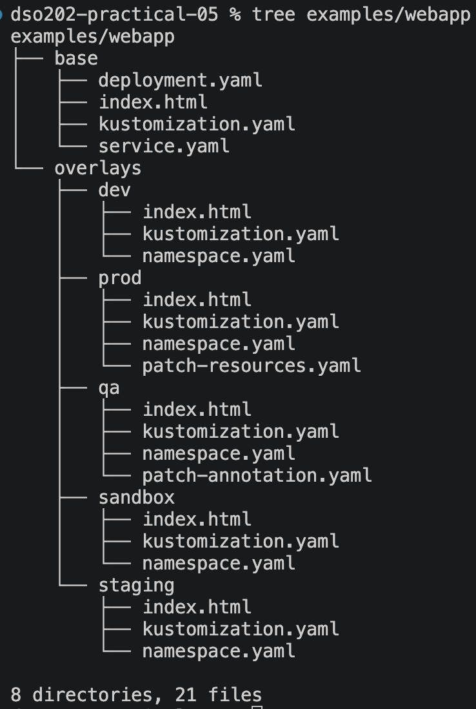

*Figure 1: Structure of the webapp chart and environment values files in dso202-practical-06.*

### Step 1: Dev release

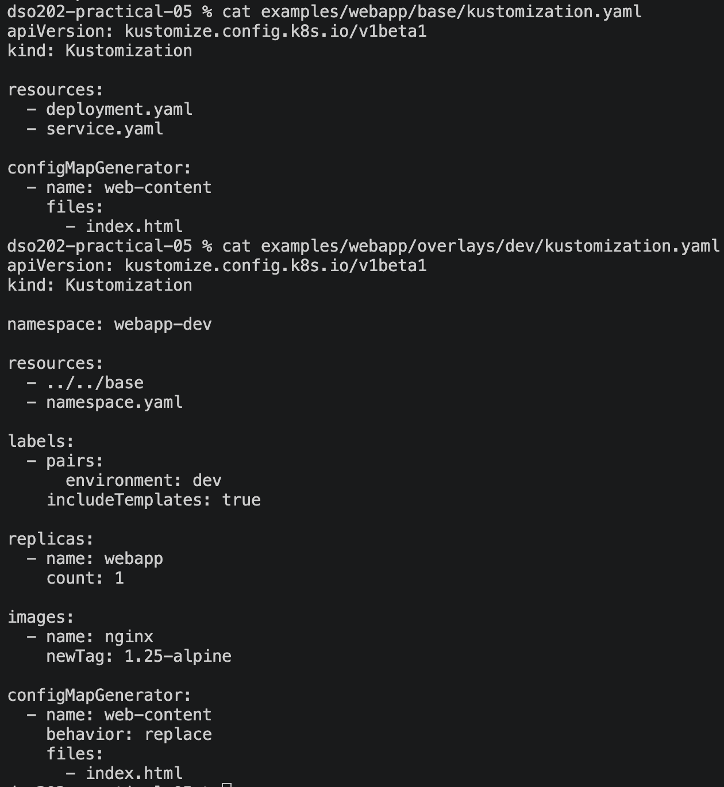

*Figure 2: Local render of the webapp chart with dev values, producing four objects (ConfigMap, Service, Deployment, test Pod) in Helm's install order, and helm lint plus helm template passing for both the dev and prod environments.*

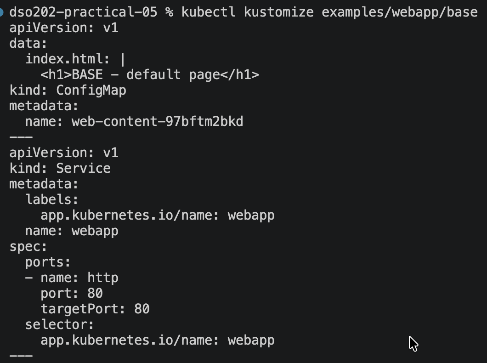

*Figure 3: Installation of the webapp-dev release, the page reached on NodePort 30080 showing Environment: dev, and the chart test webapp-dev-test-connection completing with Phase: Succeeded.*

### Step 2: Prod release

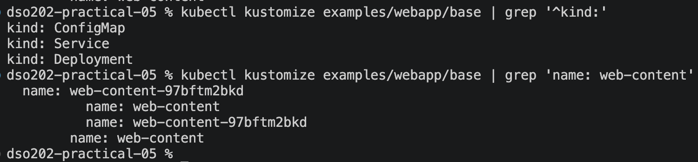

*Figure 4: The webapp-prod release running 3/3 replicas behind a ClusterIP Service, both releases listed by helm list -A, and the release history showing that running helm upgrade --install a second time created revision 2 without changing the deployed objects.*

### Step 3: Content-only upgrade (checksum rollout)

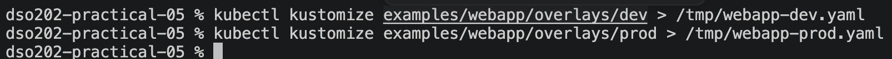

*Figure 5: The page message updated in dev.yaml and applied with helm upgrade. A new Pod with a different ReplicaSet hash replaced the old one because the checksum/config annotation changed, and the updated message is served on port 30080.*

### Step 4: Failed upgrade with automatic rollback

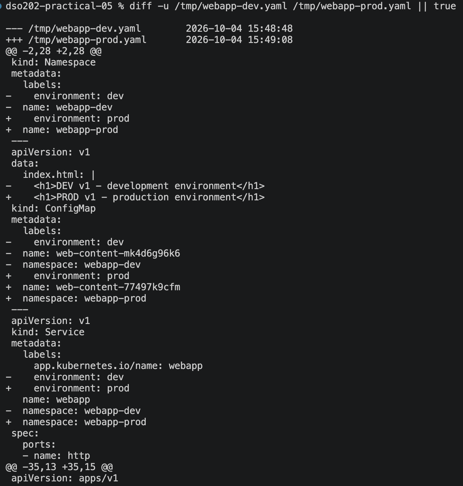
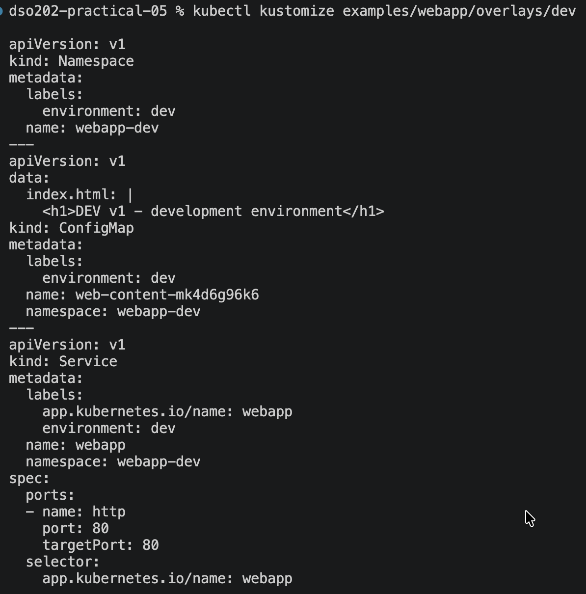

*Figure 6: Upgrade with a fake image tag fails, so Helm automatically rolls back to the last working version (revision 3 failed, revision 4 restored it).*

### Step 5: Manual rollback

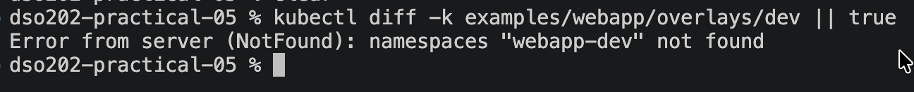

*Figure 7: Manual rollback to revision 1, saved as a new revision 5 with the original message back.*

### Step 6: NodePort clash

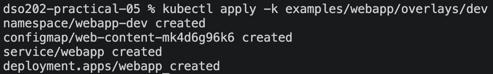

*Figure 8: A second release cannot use NodePort 30080 because webapp-dev already holds it, so the install fails.*

### Step 7: Helm won't take over objects it didn't create

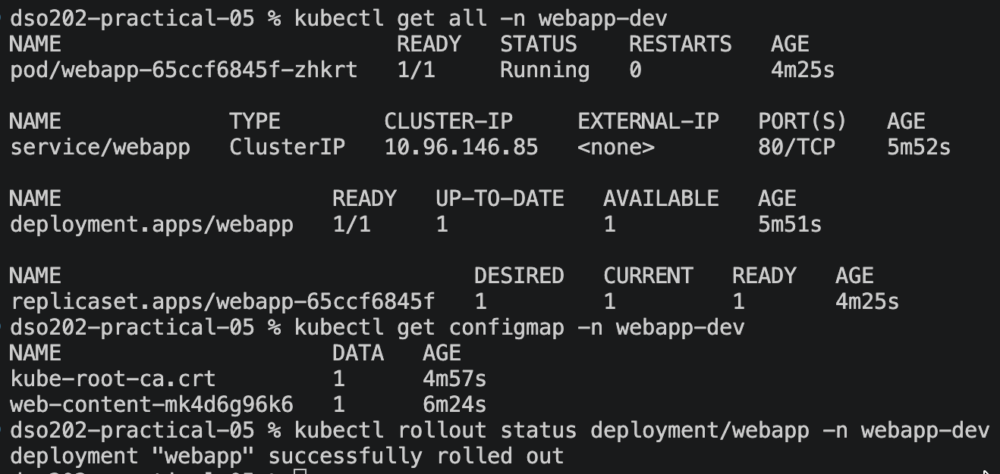

*Figure 9: Helm refuses to take over a ConfigMap made by kubectl, then adopts it once --take-ownership is given.*

### Step 8: Catching changes made behind Helm's back

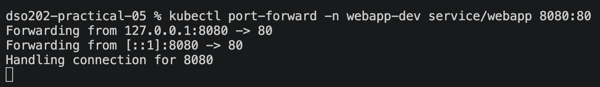

*Figure 10: Replicas changed to 5 with kubectl, so Helm 4 stops the upgrade with a conflict instead of silently overwriting it.*

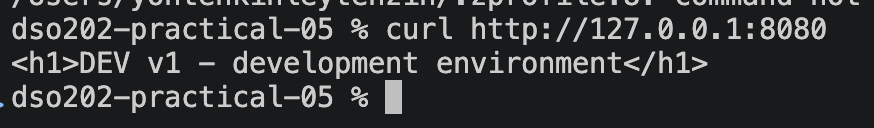

*Figure 11: With --force-conflicts, Helm takes ownership back and replicas return to 3.*

This matches the module notes: the conflict is deliberate. Controllers such as the Horizontal Pod Autoscaler legitimately change `spec.replicas`, so Helm 4 makes the disagreement visible instead of letting two managers overwrite each other.

### Step 9: Changing a selector label breaks the app

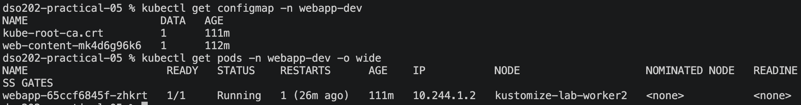

*Figure 12: Adding a label to the selector makes the upgrade fail, and the Service loses its Pods, so the site goes down.*

#### Undo the mistake and fix it

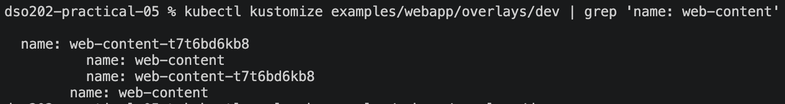

*Figure 13: After removing the bad label and upgrading again, the Service finds its Pods and the site is back.*

---
## Reflection

This practical helped me understand how Helm manages application releases, tracks changes, and rolls back failed upgrades. I learned that not all failed upgrades prevent downtime, as some changes can still affect the running application. I also gained experience troubleshooting issues with ports, cluster configuration, and Helm commands.

---
---